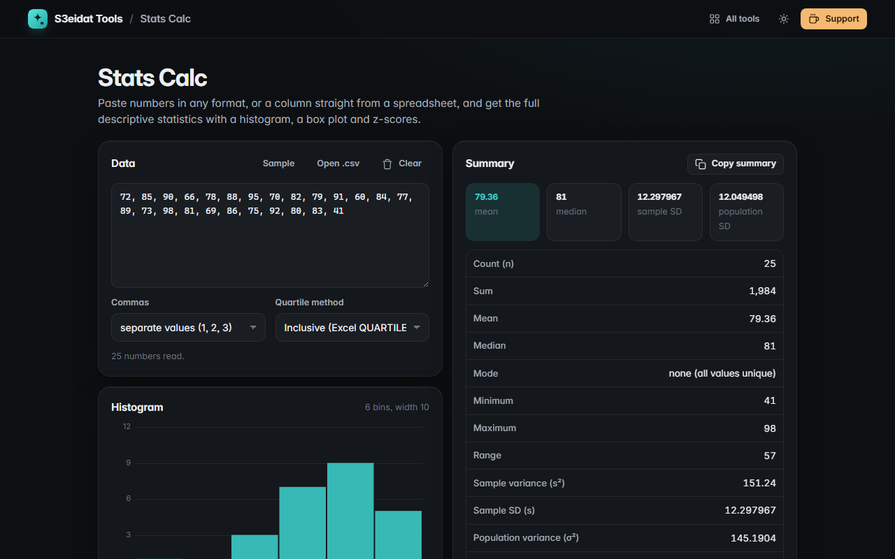

# Stats Calc

> Mean, median, standard deviation, quartiles, outliers and charts for any list of numbers. Free, private, and it runs entirely in your browser.

### ▶ [Open Stats Calc](https://s3eidat.github.io/stats-calc/)



## Features

- Paste numbers with **any separators** (commas, spaces, tabs, new lines, semicolons) or a **spreadsheet column**; headers and text are skipped and listed
- Handles **thousands separators** (`1,234`), **decimal commas** (`1,5`), Arabic-Indic digits and scientific notation
- Count, sum, **mean**, **median**, **mode(s)**, min, max, range
- **Sample and population variance and standard deviation**, standard error of the mean, coefficient of variation
- **Quartiles** with the method stated: inclusive (Excel `QUARTILE.INC`, R type 7), exclusive (`QUARTILE.EXC`, R type 6) or median of halves (TI calculators); **IQR**
- **Outliers** by the 1.5 × IQR rule
- **z-scores** for every value (using the sample SD), **frequency table** (by value, or binned for many distinct values)
- **Histogram** and **box plot**
- Copy the summary, download the frequency table and z-scores as CSV, open a `.csv` or `.txt` file

Checked by a built-in self-test: for 2, 4, 4, 4, 5, 5, 7, 9 the mean is 5, the population SD is 2 and the sample SD is 2.138.

## Privacy

Your data never leaves your device. There is no server, no account, no analytics.
The page ships with a strict Content-Security-Policy (`connect-src 'self'`), so the browser
itself blocks any attempt to send data anywhere. Your last data set is kept in local storage; **Clear** removes it.

## Run it yourself

It's plain HTML, CSS and JavaScript with no build step:

```bash
git clone https://github.com/s3eidat/stats-calc
cd stats-calc
python -m http.server 8000
```

Then open http://localhost:8000.

## Support

If this saved you time, **[buy me a coffee ☕](https://s3eidat.github.io/coffee/)**. It keeps every tool free.

---

Part of **[S3eidat Tools](https://s3eidat.github.io/)**: 100+ free, private tools that run in your browser. MIT licensed.
